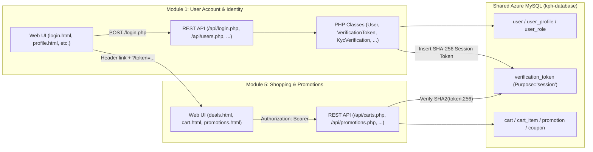

# Progress Report & Handoff Guide — Module 1: User Account & Identity (`kph_user_account_identity`)

**Prepared for:** Cristopher & Module 1 Group (User Account & Identity)  
**Prepared by:** Rich / Collaborator from Module 5 (`kph_shopping_promotions` / Coupons & Promotions)  
**Repository:** `kph_user_behavior_system` (`kph_user_account_identity`)

---

## 1. Where We Started From (Initial State from Google Drive)

When we pulled your files from the shared Google Drive folder (`BACKEND.zip`, `UI - IDK.zip`, `module_01_user_account_and_identity.sql`, `seed_roles.sql`, `BACKEND_LINE_BY_LINE.txt`, and `SQL_EXPLAINED.txt`), your group had already completed a strong foundation:

1. **Part 1 — Database Schema (`sql/`):**
   - Complete 7-table schema (`user`, `user_profile`, `user_address`, `role`, `user_role`, `kyc_verification`, `auth_identity`, `verification_token`) and default role seed script (`buyer`, `seller`, `admin`).
2. **Part 2 — Backend PHP Classes (`config/`, `classes/`):**
   - Complete OOP classes using `PDO` + prepared statements, `Validator.php`, `Crypto.php` (AES-256-GCM encryption for KYC ID numbers and HMAC-SHA256 for OTP/reset codes), `Exceptions.php`, `User.php`, `UserProfile.php`, `UserAddress.php`, `KycVerification.php`, `VerificationToken.php`, `Role.php`, `UserRole.php`, `AuthIdentity.php`, and `ModuleApi.php`.
3. **Part 4 — UI-First Frontend (`web/`):**
   - All 13 responsive HTML pages (`login.html`, `register.html`, `social.html`, `forgot-password.html`, `reset-password.html`, `home.html`, `profile.html`, `profile-edit.html`, `addresses.html`, `kyc.html`, `delete-account.html`, `activity.html`, `wishlist.html`) were built and styled, running in browser-only demo mode (`const USE_API = false;` powered by `js/demo.js`).
4. **What Was Missing:**
   - **Part 3 (REST API `api/`)** had not been started yet, the **Part 4 Frontend** was not yet wired to real PHP endpoints (`USE_API = true`), and there was no **Cross-Module Session Token mechanism** to let other modules (like Module 5: Shopping & Promotions) recognize who logged in on Module 1.

---

## 2. What Was Preserved (100% of Your Original Work)

- **All Pre-Existing UI Design & Layouts (`web/`):** Every single HTML file, CSS file (`kph.css`, `module.css`), image (`web/images/`), Region > Province > City > Barangay address picker (`addresses.html`), 6-digit verification box (`profile-edit.html`), and logout confirmation dialog (`demo.js`) was kept **100% intact**.
- **All Original Backend Classes & Presentation Scripts (`classes/`, `kph_reference_docs/`):** Every class name, constant, and method signature documented in your `BACKEND_LINE_BY_LINE.txt`, `FUNCTION_LIST.txt`, and `SQL_EXPLAINED.txt` was preserved so your group can still use those exact scripts for your presentation/defense.

---

## 3. What Changed & What Was Added

### A. Built All Part 3 REST API Endpoints (`kph_user_account_identity/api/`)
We built the complete 10-endpoint REST API layer plus sample mocks (`api/mock/`) and full documentation (`docs/endpoints.md`):
- **`api/helpers.php`:** Shared CORS & JSON headers, request body parser (`jsonBody()`), exception-to-HTTP status mapper (`InvalidArgumentException` -> `400`, `AuthenticationException` -> `401`, `ForbiddenException` -> `403`, `OutOfBoundsException` -> `404`), and Bearer token authentication (`currentUser()`, `requireUser()`, `isAdminUser()`, `hasModuleKey()`).
- **`api/login.php`:**
  - `POST`: Authenticates email/phone + password (`User::login()`), creates a 24-hour Bearer session token, and returns `{ UserID, Token, User }`.
  - `GET`: Validates the active Bearer token and returns the logged-in user's full account view.
  - `DELETE`: Revokes the Bearer token on logout.
- **`api/users.php`:**
  - `POST`: Registers a new user (`User::register()`) and immediately returns `{ UserID, Token, User }`.
  - `GET`: Returns full account view for owner/admin/module-key, public view for other users, or filtered user list (`?all=1`, `?status=`, `?search=`).
  - `PUT`: Updates `user` fields (`FirstName`, `MiddleName`, `LastName`, `Email`, `PhoneNumber`) and `user_profile` fields (`Username`, `Bio`, `ProfilePictureURL`, `DateOfBirth`) in one request.
  - `POST ?action=change-password`, `POST ?id=<id>&action=suspend`, `POST ?id=<id>&action=reactivate`.
  - `DELETE`: Verifies password and deletes the user account (`User::deleteAccount()`).
- **`api/social.php`:** Connects `social.html` (Google / Facebook sign-in & registration) to `User::socialLogin()` and issues a Bearer session token.
- **`api/addresses.php`:** Connects `addresses.html` (`GET`, `POST`, `PUT ?id=`, `DELETE ?id=`) to `UserAddress`, automatically translating UI fields (`RecipientFullName`, combined `Street`, `Region`) into the database columns (`RecipientFirstName`, `RecipientLastName`, `HouseUnitNumber`, `Street`).
- **`api/verification.php` & `api/contact-change.php`:** Connects the 6-digit email/phone verification and contact-change flows in `profile-edit.html` (`POST` to send code, `PUT` to confirm code).
- **`api/password-reset.php`:** Connects `forgot-password.html` (`POST`) and `reset-password.html` (`GET ?token=` pre-check and `PUT` password update).
- **`api/kyc.php`:** Connects `kyc.html` (`GET` status, `POST` submission, plus admin `?action=approve` which auto-assigns the `seller` role and `?action=reject`).
- **`api/roles.php` & `api/activity.php`:** Role assignment endpoints and login/session/search/view activity history for `activity.html`.

### B. Connected Frontend to Live API (`USE_API = true`)
- Switched `const USE_API = false;` to `const USE_API = true;` across all HTML pages in `web/`.
- Updated `web/js/api.js`, `web/js/config.js`, `web/js/kph-ui.js`, and `web/js/demo.js` so real API logins work seamlessly with the existing header badges and logout dialog.
- Added `config/config.local.php` (gitignored) + `config/config.local.example.php` so each developer can connect to the shared **Azure MySQL** database (`kamaera-ph-mysql.mysql.database.azure.com`) or local XAMPP MySQL without overwriting Git-tracked config files.

---

## 4. New Feature Explained: Cross-Module Bearer Session Token Handoff (Why It Was Needed & How It Works)

### Why It Was Needed
In KameraPH's multi-module architecture, **Module 1 (`kph_user_account_identity`)** handles login and registration, while **Module 5 (`kph_shopping_promotions`)** handles the Shopping Cart, Deals, Coupons, and Seller Promotions (and other groups run Catalog, Orders, Auctions, etc.).
- Because different groups may run their modules on different folders or even different localhost ports during integration testing, standard PHP `$_SESSION` cookies do not work across origins, and hardcoding `testUserId: "1"` in `config.js` meant every module always acted as User #1 regardless of who actually logged in.

### How It Works
1. **Token Creation (`VerificationToken::createSession`):**
   - When a user logs in (`login.php`), registers (`users.php`), or uses Google/Facebook (`social.php`), Module 1 generates a 64-character random hex token (`bin2hex(random_bytes(32))`) and stores its **SHA-256 hash** (`hash("sha256", $token)`) in the shared `verification_token` table with `Purpose = 'session'` and a 24-hour expiration (`1440` minutes).
2. **Browser Storage & Header Injection (`web/js/api.js`):**
   - The frontend stores the token in `localStorage.getItem("kph-auth-token")` and the user profile in `localStorage.getItem("kph-user")`.
   - Every `apiGet()` / `apiSend()` / `kphFetch()` request automatically attaches `Authorization: Bearer <token>`.
3. **Cross-Module Link Handoff (`web/js/kph-ui.js`):**
   - When a user clicks **Deals** or the **Cart icon** in the header, `kph-ui.js` appends `?token=<token>` to the link when navigating to another module.
   - The receiving module's `api.js` automatically captures `?token=` into its own `localStorage`, strips `?token=` from the address bar via `history.replaceState`, and sends `Authorization: Bearer <token>` to its own PHP API.
4. **Shared Database Validation & Instant Logout:**
   - Both Module 1 (`VerificationToken::verifySession`) and Module 5 (`api/helpers.php`) validate the Bearer token against `verification_token` (`WHERE TokenHash = SHA2(:token, 256) AND ExpiresAt > NOW() AND UsedAt IS NULL`).
   - When the user clicks **Log out**, `DELETE /api/login.php` sets `UsedAt = NOW(), ExpiresAt = NOW()` on that row in `verification_token`, immediately logging the user out of **all modules** at once.

---

## 5. Azure Database Utilization (`Azure Database for MySQL 8.0 Flexible Server`)

### Why We Use a Shared Azure Cloud Database Instead of Separate Local MySQL Instances
If every group runs its own separate `localhost` XAMPP MySQL database, **Module 1's registered users, session tokens, addresses, and KYC statuses do not exist on Module 5's machine**, making real cross-module testing impossible. By pointing all modules to the shared **Azure Database for MySQL 8.0 Flexible Server** (`kph-database`):
- Every module reads and writes against one **single source of truth**.
- A user created in Module 1 (`register.html` / `POST /api/users.php`) immediately has a valid `UserID` for carts, coupons, orders, seller verification, and reviews across all other groups' modules.
- Foreign keys across modules (e.g., `cart.UserID -> user.UserID`, `kyc_verification.ReviewedByAdminID -> admin_user.AdminID`, `orders.BuyerID -> user.UserID`) remain intact and enforced at the database level.

### How It Is Wired in Module 1 (`config.php` + `config.local.php` + `Database.php`)
1. **Safe Defaults + Local Overrides ([`config.php`](file:///c:/xampp/htdocs/kph_user_behavior_system/kph_user_account_identity/config/config.php)):**
   - `config/config.php` keeps safe `localhost` defaults tracked in Git, and automatically checks for `config/config.local.php` using `array_replace_recursive($config, $localConfig)`.
   - Your local Azure credentials live in `config/config.local.php` (created from [`config.local.example.php`](file:///c:/xampp/htdocs/kph_user_behavior_system/kph_user_account_identity/config/config.local.example.php)), which is excluded in `.gitignore` so database credentials are never exposed on GitHub.
2. **PDO Connection ([`Database.php`](file:///c:/xampp/htdocs/kph_user_behavior_system/kph_user_account_identity/config/Database.php)):**
   - Connects via PHP `PDO` (`mysql:host=...;port=3306;dbname=...;charset=utf8mb4`) using a singleton pattern (one connection reused for the entire HTTP request) with `ERRMODE_EXCEPTION`, `DEFAULT_FETCH_MODE => FETCH_ASSOC`, and native prepared statements (`EMULATE_PREPARES => false`).
3. **Cross-Module Database Interactions:**
   - **Shared `verification_token` table:** Module 1 inserts SHA-256 session tokens (`Purpose = 'session'`) on login/register/social sign-in; Module 5 (`kph_shopping_promotions/api/helpers.php`) queries the exact same `verification_token` table on Azure using `SHA2(:hashed, 256)` to authenticate `Authorization: Bearer <token>` requests without calling Module 1 over HTTP on every request.
   - **Shared `user` & `cart` tables:** Verified during testing (`backend_test.php` and `api_test.php`), when deleting a test user in Module 1 (`User::deleteAccount()`), it cleans up child rows in `cart_item` / `cart` before deleting the parent `user` row so Azure MySQL's cross-module foreign key constraints stay satisfied.
   - **Admin Foreign Keys (`kyc_verification`):** Approving KYC records `ReviewedByAdminID` referencing the shared `admin_user.AdminID` table (`AdminID = 1`) in `kph-database`.

---

## 6. Overall System Architecture

---

## 7. Suggestions & Next Steps for Module 1 Group (Including UI Improvements)

Everything required by the KameraPH Build Guide (Parts 1, 2, 3, and 4) is working and passing all 32 automated tests (`backend_test.php` and `api_test.php`). If your group wants to polish the project further before final presentation, here are recommended next steps:

### UI / UX Improvements
1. **Show Active User Avatar / Name in the Top Header (`kph-ui.js`):**
   - Right now the top-right account icon is a static user silhouette. You can read `KPHAuth.getUser()` in `kph-ui.js` to display the logged-in user's `@Username` or initial badge next to the account icon (and show a **"Log in"** button when logged out).
2. **Real Image File Upload Preview & Storage on `profile-edit.html` and `kyc.html`:**
   - Currently `profile-edit.html` previews the selected avatar locally via `URL.createObjectURL(file)`, and `kyc.html` sends `IDType` and `IDNumber` as JSON. If you want real file uploads saved to `uploads/avatars/` and `uploads/kyc/`, you can switch the `kyc.html` and `profile-edit.html` forms to submit `FormData` (`multipart/form-data`) so PHP saves the uploaded `.jpg`/`.png` files to disk.
3. **Admin KYC Review & User Management Page (`admin-kyc.html`):**
   - Your backend and API already support listing pending KYC submissions (`GET /api/kyc.php?all=1&status=Pending`), approving/rejecting them (`POST /api/kyc.php?id=<id>&action=approve|reject`), and suspending/reactivating users (`POST /api/users.php?id=<id>&action=suspend|reactivate`). Adding a simple Admin Review table page in `web/` would let you demo approving a seller's ID live in the browser without using Postman/CLI!
4. **Password Change Section on `profile-edit.html`:**
   - The API already supports `POST /api/users.php?action=change-password` (`{ CurrentPassword, NewPassword }`). Adding a collapsible "Change password" card on `profile-edit.html` will let logged-in users update their password without going through the "Forgot password" flow.
5. **Toast Notifications & Loading Spinners:**
   - Add a subtle loading state (`Saving...` / disabled button) on all form submit buttons while waiting for Azure MySQL responses so users get instant visual feedback.
